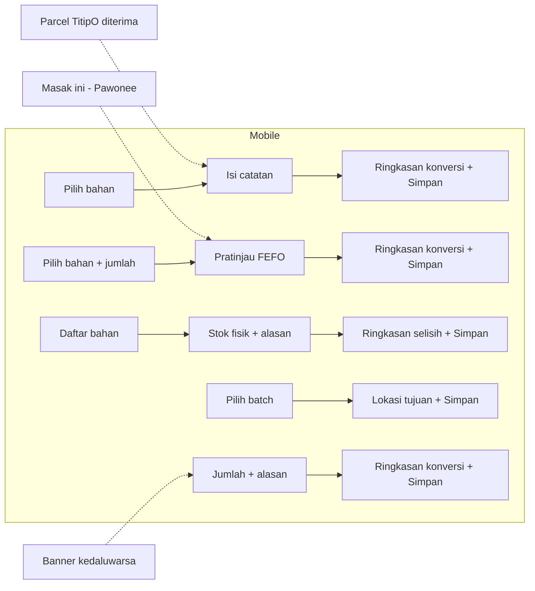

# Flow lima alur catat stok (PDR-DSG-003)

Sumber requirement: `produk/10-alur-catat-stok.md` (Pedaree-TownHall, Alur A-E + Aturan Umum). Dokumen ini hanya menerjemahkannya ke
layar dan langkah; tidak menambah/menghapus alur. Kontrak data: `docs/api/openapi.yaml` backend (PR pedaree-backend-service#9, belum merge).
Nama status dan token: `docs/TOKEN.md`.

## Aturan yang berlaku untuk semua alur

| Aturan | Sumber | Penerapan di desain |
|---|---|---|
| Maks 3 layar mobile, maks 2 langkah web | Aturan Umum | Tabel layar per alur di bawah; jumlah dihitung sejak titik masuk sampai tersimpan. Layar hasil adalah keadaan layar terakhir, bukan layar baru |
| Tombol Simpan selalu didahului ringkasan konversi (`2 ikat = 400 g`) | Aturan Umum | Komponen `RingkasanKonversi` (bagian "Layar ringkasan konversi"); wajib di layar terakhir sebelum Simpan |
| Pratinjau batch FEFO pada Catat Pakai | Alur B langkah 2 | Komponen `PratinjauFefo` |
| Dapat dilakukan luring (mobile) | Aturan Umum | Keadaan `Tersimpan di antrean` pada layar terakhir. ASUMSI: perilaku antrean mengikuti `platform/60-offline-sinkron.md` (tidak dibaca di putaran ini) |
| Stok jadi 0 atau <= minimum memicu sinyal demand | Aturan Umum | Tidak ada layar tambahan; hasil menampilkan lencana status stok baru (`warna.stok.*`). Sinyal ke TitipO = anjuran, bukan pesanan |
| `X-Request-Id` (UUID) di setiap POST | openapi bab idempotensi | Dibuat saat layar terakhir dibuka, dipakai ulang bila Simpan diulang (retry aman) |

Prasyarat sesi: akun dibuat OPERATOR, jadi TIDAK ada layar daftar publik di mobile maupun web; titik masuk hanya `Masuk` (`POST /auth/login`).
Galat `401` pada alur apa pun mengarahkan ke layar Masuk lalu kembali ke layar terakhir dengan isian terjaga. Lupa kata sandi = hubungi operator (teks bantuan; tanpa alur pemulihan mandiri).

## Layar dan langkah per alur

Notasi: `M1..M3` layar mobile (Compose, Navigation3), `W1..W2` langkah web (SvelteKit). `testTag`/`id` untuk Maestro (siklus 2) dibentuk `alur/layar`, mis. `masuk/pilih-bahan`.

### Alur A - Catat Masuk (`POST /pantry/items` bila kartu baru, `POST /pantry/batches`)

| Layar | Isi | testTag/id |
|---|---|---|
| M1 Pilih bahan | Pencarian + daftar bahan (12 bahan baku di atas), tombol `Kartu baru` | `masuk/pilih-bahan` |
| M2 Isi catatan | jumlah + satuan, tanggal masuk (default hari ini, mundur maks 7 hari), tanggal kedaluwarsa (default masuk + umur simpan, dapat diubah; kosong = null hanya bila umur 0), lokasi (default `lokasiDefault`). Untuk `Kartu baru`: nama, kategori, satuan, minimum, umur, lokasi tampil di layar yang sama sebagai bagian atas formulir | `masuk/isi` |
| M3 Ringkasan + Simpan | `RingkasanKonversi`, label status kedaluwarsa hasil (token `warna.kedaluwarsa.*` dengan label `H-n`), tombol `Simpan` | `masuk/ringkasan` |
| Hasil | Keadaan M3 setelah simpan: `Batch tersimpan`, lencana stok baru, tombol `Catat lagi` / `Selesai` | `masuk/hasil` |

Web: W1 pilih bahan (atau kartu baru) dan isi catatan dalam satu formulir; W2 ringkasan konversi + `Simpan`.
Pintasan: parcel TitipO diterima membuka draf langsung di M2 (web: W1) terisi dari isi parcel; pengguna menekan `Simpan` atau mengoreksi jumlah.
Validasi tampil sebelum M3: jumlah > 0; tanggal masuk bukan masa depan; kedaluwarsa >= masuk; tolak > 50.000 g/ml per batch (pesan `pecah menjadi beberapa batch`); satuan hitung wajib bulat.

### Alur B - Catat Pakai (`POST /pantry/consume`)

| Layar | Isi | testTag/id |
|---|---|---|
| M1 Pilih bahan + jumlah | Satu atau banyak bahan, jumlah per bahan. Dari tombol `Masak ini` (Pawonee) layar ini dilewati: daftar bahan datang terisi dan alur mulai dari M2 | `pakai/isi` |
| M2 Pratinjau FEFO | `PratinjauFefo` per bahan, termasuk baris `kurang 200 g tomat` + tombol `Tambah ke TitipO` bila stok kurang | `pakai/pratinjau` |
| M3 Ringkasan + Simpan | `RingkasanKonversi` per bahan, `Simpan` | `pakai/ringkasan` |
| Hasil | `terpotong` per batch, `kurang` bila ada, lencana status stok baru | `pakai/hasil` |

Web: W1 pilih bahan + jumlah dengan `PratinjauFefo` (lihat batasan di bawah); W2 ringkasan konversi + `Simpan`.
Aturan tampil: batch `KEDALUWARSA` tidak muncul sebagai sumber (terkunci, abu-merah, `tidak dapat dipakai`); stok 0 (atau hanya batch kedaluwarsa) memblokir `Simpan` dengan pesan `stok habis` (server menolak `422 STOK_HABIS`, tidak ada yang terpotong).
`Tambah ke TitipO` meneruskan sinyal demand (anjuran restock saja, tidak membuat pesanan otomatis; teks bantu `anjuran, bukan pesanan`).

### Alur C - Opname / Koreksi (`POST /pantry/opname`)

| Layar | Isi | testTag/id |
|---|---|---|
| M1 Daftar bahan | stok catat per bahan (lencana status stok), pilih bahan | `opname/daftar` |
| M2 Stok fisik + alasan | input stok fisik (satuan sama dengan tampil), alasan wajib (3-140 karakter; saran cepat `tumpah`, `susut bayam`, `salah takar kemarin`); selisih langsung tampil (`- 150 g`) | `opname/isi` |
| M3 Ringkasan + Simpan | `RingkasanKonversi`, jenis dampak: selisih negatif = ambil dari batch FEFO (tampilkan batch), positif = batch baru `MASUK_KOREKSI` dengan kedaluwarsa hari ini + umur default; `Simpan` | `opname/ringkasan` |

Web: W1 tabel dengan kolom input stok fisik + alasan per baris yang diubah; W2 ringkasan selisih + `Simpan`.
Konflik: `409 KONFLIK_OPNAME` (stok catat berubah sejak dilihat; klien mengirim `stokCatatTerakhir`) menampilkan banner `Stok berubah, muat ulang` dan kembali ke M2/W1 dengan angka baru; isian pengguna dipertahankan. Selisih nol: ringkasan `Tidak ada selisih` dan `Simpan` dinonaktifkan.

### Alur D - Pindah Lokasi (`POST /pantry/batches/{id}/pindah`)

| Layar | Isi | testTag/id |
|---|---|---|
| M1 Pilih batch | masuk dari detail batch (tombol `Pindah`), atau pilih dari daftar batch item | `pindah/pilih-batch` |
| M2 Lokasi tujuan + Simpan | pilih lokasi tujuan (5 lokasi baku), ringkasan satu baris `Batch btc_... : KULKAS_BAWAH -> FREEZER` (tanpa perubahan jumlah), `Simpan` | `pindah/tujuan` |
| Hasil | lokasi baru dan tautan `Lihat riwayat pindah` (riwayat tampil di detail batch) | `pindah/hasil` |

Web: W1 pilih batch dan lokasi tujuan; W2 ringkasan + `Simpan`. Karena tidak ada jumlah, `RingkasanKonversi` berisi satu baris lokasi (varian `tanpa-jumlah`).
Bahan beku (`FREEZER`) menambah keterangan `beku` pada label status; ambang tidak berubah (SOP bab 6).

### Alur E - Buang Kedaluwarsa / Rusak (`POST /pantry/batches/{id}/buang`)

| Layar | Isi | testTag/id |
|---|---|---|
| M1 Jumlah + alasan | masuk dari banner kedaluwarsa atau detail batch; jumlah (default seluruh sisa), alasan dari daftar baku: `busuk`, `berlendir/berbau`, `lewat tanggal`, `tercemar` (pilihan tunggal, tanpa teks bebas) | `buang/isi` |
| M2 Ringkasan + Simpan | `RingkasanKonversi`, dampak (`masuk metrik waste bulan ini`; batch menjadi `DIBUANG` bila sisa 0), `Simpan` bernada hati-hati (bukan merah penuh bila batch belum lewat tanggal) | `buang/ringkasan` |
| Hasil | `Tercatat sebagai waste`, sisa batch bila buang sebagian | `buang/hasil` |

Web: W1 jumlah + alasan; W2 ringkasan + `Simpan`.
Batch `KEDALUWARSA`: ini satu-satunya aksi yang ditawarkan (`Buang dan catat`). Buang sebagian diizinkan (jumlah <= jumlahAktif); sisa tetap `AKTIF` bila belum lewat tanggal.

### Rekapitulasi batas

| Alur | Layar mobile | Langkah web |
|---|---|---|
| A Masuk | 3 | 2 |
| B Pakai | 3 (2 bila dari Pawonee) | 2 |
| C Opname | 3 | 2 |
| D Pindah | 2 | 2 |
| E Buang | 2 | 2 |

Semua <= batas Aturan Umum (3 mobile, 2 web).

## Diagram

## Layar ringkasan konversi

Komponen `RingkasanKonversi` (mobile: layar/bagian terakhir; web: langkah W2). Satu baris per bahan.

- Format: `{jumlah input} {satuan tampil} = {jumlah simpan} {satuan simpan}`, contoh `2 ikat = 400 g` (bayam), `3 sdm = 45 ml` (minyak), `1 kg = 1.000 g` (beras).
- Pembulatan dan pemisah ribuan mengikuti `inventori/20-satuan-hortikultura.md` bab 3 (`1.500 g`; 1 desimal bila < 1000; satuan hitung selalu bulat).
- Bila satuan input sama dengan satuan simpan: tampilkan `500 g` dengan keterangan `tanpa konversi` (ringkasan tetap tampil agar perilaku konsisten).
- Konversi tidak berlaku (sel `-` di tabel bobot acuan): baris galat `satuan tidak berlaku untuk komoditas ini`, `Simpan` dinonaktifkan.
- `Simpan` baru aktif setelah ringkasan tampil tanpa galat; ringkasan dihitung ulang tiap isian berubah.
- Aksesibel: teks utama kontras >= 4,5:1 (`warna.permukaan.teks`), tanda sama dengan dibaca pembaca layar sebagai `sama dengan`; tidak bergantung warna.
- Sumber hitung mobile: modul `:shared:pantry-resep` (milik Pawonee, hanya dikonsumsi). Sumber hitung web: LIHAT batasan web di bawah.

## Pratinjau batch FEFO

Komponen `PratinjauFefo` (Alur B; juga dipakai ulang di ringkasan Alur C untuk koreksi negatif).

- Urutan baris: `tanggalKedaluwarsa` terdekat dulu; `null` terakhir dan berlabel `tanpa tanggal (urut tertua)`.
- Baris: `{lokasi} · kedaluwarsa {tanggal} · {status+label H-n} · -{jumlah terpotong}` dengan lencana `warna.kedaluwarsa.*` + ikon (bukan warna saja).
- Batch `KEDALUWARSA`: ditampilkan abu-merah, ikon silang, tidak ikut terpotong, label `terkunci`.
- Kurang stok: baris tebal `kurang {n} g {bahan}` + `Tambah ke TitipO`; bila sama sekali tidak ada stok yang dapat dipakai: galat `stok habis` dan `Simpan` nonaktif.
- Sumber mobile: `pilihBatchFefo` dari `:shared:pantry-resep`. Pratinjau hanya menampilkan; angka akhir tetap dari respons server (`terpotong`, `kurang`), dan bila berbeda tampilan hasil mengikuti server.

## Batasan web (menunggu kontrak)

Aturan `pedaree-web`: dilarang menghitung stok/FEFO di klien. Kontrak saat ini TIDAK punya endpoint pratinjau/konversi:
- `GET /pantry/items/{id}` memberi batch sudah urut FEFO (dapat dipakai untuk menampilkan urutan batch, tanpa alokasi jumlah).
- Alokasi jumlah per batch (`PratinjauFefo` lengkap) dan angka konversi pada W2 butuh endpoint dry-run atau pratinjau. STATUS: MENUNGGU KONTRAK (usulan: `POST /pantry/consume?dryRun=true` dan `POST /pantry/convert`; tiket backend baru, diputuskan manajer/manusia, tidak dibuat di sini).
- Sampai itu ada, web memakai: urutan batch dari detail item (tanpa alokasi) dan konversi ditampilkan setelah server menolak/menerima; RISIKO: langkah W2 tidak dapat memenuhi aturan "ringkasan konversi sebelum simpan" sepenuhnya. Keputusan manusia diperlukan (lihat PR).

## Perubahan yang termasuk "flow besar" (wajib PRD/FSD versi baru di TownHall)

Tidak boleh dilakukan di repo ini: menambah atau menghapus alur di luar A-E; melampaui 3 layar mobile / 2 langkah web; menambah layar daftar/registrasi publik (keputusan: akun dibuat operator); membuat pesanan TitipO otomatis; push browser di web (Varian 1 tanpa); mengubah urutan FEFO atau aturan buang. Perubahan layar kecil (teks, tata letak, urutan field) boleh lewat PR desain biasa.

## Asumsi yang ditandai

1. Jumlah layar per alur (D dan E dua layar) adalah rancangan desain; requirement hanya menetapkan batas maks.
2. Kartu baru (Alur A) digabung ke layar M2, bukan layar tersendiri, agar tetap <= 3.
3. Nama `testTag`/`id` adalah usulan untuk siklus uji Maestro.
4. Antrean luring mengikuti dokumen `platform/60-offline-sinkron.md` yang belum dibaca; hanya keadaan UI yang ditentukan di sini.
5. Daftar `Lokasi` (5) dan `Satuan` (13) mengikuti openapi backend PR #9.
